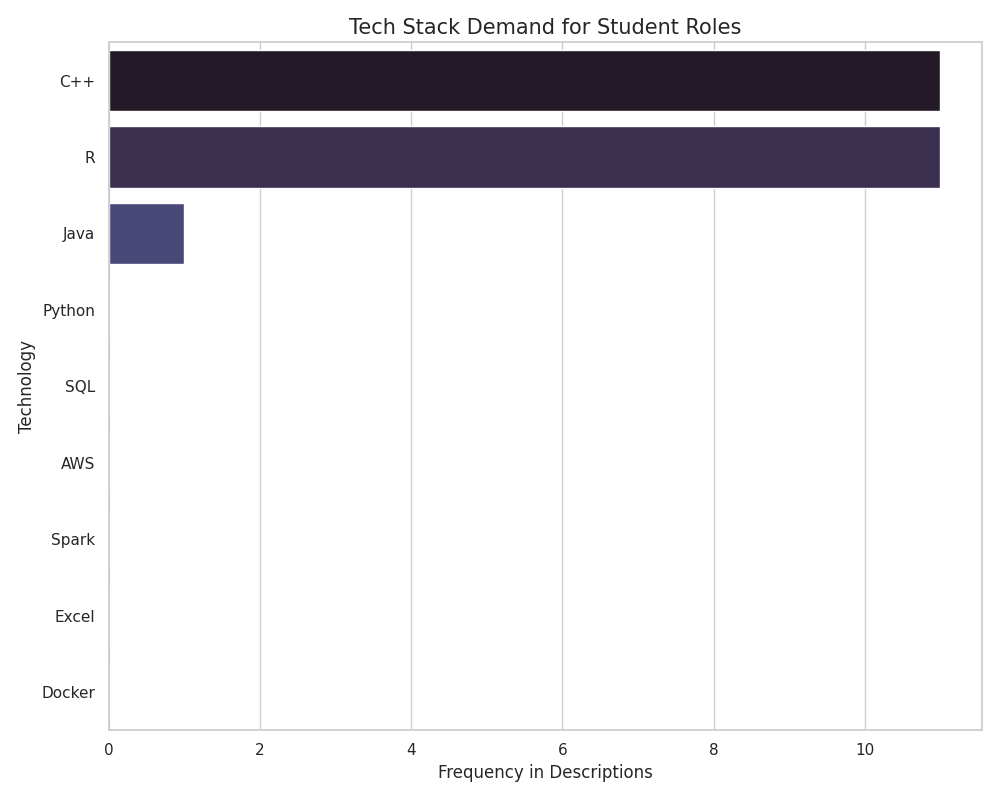
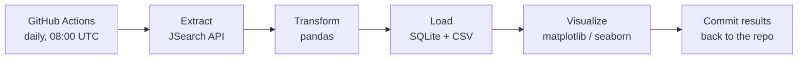

# Student Tech Job Tracker (Israel)

An automated ETL pipeline that collects entry-level tech job postings in Israel every day, cleans them, stores them in a database, and charts which technologies employers ask for most.

I built it to answer a question I had as a Data & Information Engineering student: *which skills do student positions in Israel actually require?*



## How it works



| Stage | File | What it does |
| --- | --- | --- |
| Extract | `extract.py` | Queries the JSearch API (RapidAPI) for *Data*, *Software* and *DevOps* student roles in Israel |
| Transform | `transform.py` | Maps the API fields to a clean schema, trims descriptions, drops duplicates and rows missing a title or company |
| Load | `load.py` | Writes the cleaned table to SQLite (`cleaned_jobs`) and exports `all_jobs.csv` |
| Visualize | `visualize.py` | Counts how often each technology appears in job descriptions and saves `top_technologies.png` |
| Orchestrate | `main.py`, `.github/workflows/Daily_Job_Tracker.yml` | Runs the four stages in order, every day, with the API key stored as a GitHub secret |

## Tech stack

Python · pandas · SQLite · matplotlib / seaborn · GitHub Actions · REST API

## Running locally

```bash
git clone https://github.com/liorcohen1606/data-jobs-etl-pipeline.git
cd data-jobs-etl-pipeline
python -m venv venv
source venv/bin/activate        # Windows: venv\Scripts\activate
pip install -r requirements.txt
export RAPID_API_KEY=your_key   # Windows: set RAPID_API_KEY=your_key
python main.py
```

You need a free JSearch API key from [RapidAPI](https://rapidapi.com).

## Design decisions

- **API key from the environment.** The key is read from `RAPID_API_KEY`, so the same code runs locally and in GitHub Actions without any secret in the repository.
- **One file per stage.** Extract, transform, load and visualize are independent functions, so each stage can be tested or replaced on its own.
- **GitHub Actions as a free scheduler.** Good enough for one daily run, without managing a server.

## Known limitations and what's next

- **Daily snapshot, not history.** The load step replaces the table on each run, so the database holds only the latest day. Next: incremental loading with a `fetched_at` date, so trends over time can be analyzed.
- **Data is stored in git.** The daily results are committed back to the repo. Next: move raw and processed data to cloud storage and a warehouse (BigQuery or Postgres).
- **Keyword matching.** Technologies are counted with simple substring search, which is noisy (for example, the letter "R"). Next: extract skills from descriptions with an LLM.
- **No tests yet.** Next: unit tests for the transform step and a CI job that runs them on every push.
